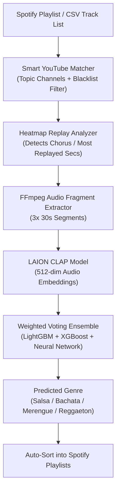

# LatinMusicClassifier 🎵💃

[](https://colab.research.google.com/drive/16eKIzUglyetO7LGzqu1aY0Cnx7wxilyN?usp=sharing)
[](https://www.kaggle.com/g5fighter)
[](https://opensource.org/licenses/MIT)
[](https://www.python.org/downloads/)
[](https://pytorch.org/)
[](https://huggingface.co/laion/clap-htsat-unfused)

An end-to-end Deep Learning and Audio Processing pipeline designed to accurately classify Latin music tracks into four core genres: **Salsa**, **Bachata**, **Merengue**, and **Reggaeton**.

The system leverages **Microsoft/LAION CLAP (Contrastive Language-Audio Pretraining)** audio embeddings combined with an ensemble classifier (LightGBM, XGBoost, and Neural Networks) trained on real-world playlists.

---

## 🌟 Key Features

1. **Intelligent YouTube Audio Resolver**:
   - Multi-tier cascaded search prioritizing artist `- Topic` channels for studio-grade audio quality.
   - Heuristic blacklist filtering to discard interviews, TV clips, live covers, and non-musical chatter.
   - **Heatmap Replay Extraction**: Uses YouTube's playback heatmap to pinpoint the most replayed fragments (the core hook and chorus), maximizing genre discriminability.

2. **Zero-Shot & Few-Shot Audio Embeddings**:
   - Utilizes `laion/clap-htsat-unfused` to generate 512-dimensional semantic audio representations.
   - Optimized for half-precision (`FP16`) on NVIDIA RTX GPUs for 50–70% speedup.

3. **Weighted Voting Ensemble Classifier**:
   - Combines predictions from **LightGBM**, **XGBoost**, and a multi-layer **Neural Network**.
   - Model weights and label encoders are fetched on demand via `kagglehub` from [@g5fighter's Kaggle Models](https://www.kaggle.com/models/g5fighter/latin-music-genre-classifiers).

4. **Spotify Playlist Subdivider**:
   - Reads any unorganized source playlist from Spotify, extracts audio, classifies each track, and distributes songs into dedicated genre playlists automatically.
   - Powered by [MusicCore](https://github.com/lagosproject/MusicCore) for exponential backoff on HTTP 429 rate limits and resilient token caching.

---

## 🏗️ Architecture



---

## 📁 Repository Structure

```text
LatinMusicClassifier/
├── config/
│   └── .gitkeep                 # Config directory (cookies/tokens are ignored)
├── notebooks/
│   ├── dataset-generator.ipynb  # Interactive dataset generation notebook
│   ├── music-classifier.ipynb   # Model training & cross-validation notebook
│   ├── music-classifier-demo.ipynb # Quick inference demo
│   └── Spotify_Playlist_Extractor_Kaggle.ipynb # Spotify playlist scraper
├── scripts/
│   ├── generate_dataset.py      # Batch audio download & CLAP embeddings extractor
│   ├── subdivide_playlist.py    # End-to-end Spotify playlist genre classifier & sorter
│   ├── predict_genres.py        # Offline batch inference script
│   ├── setup_datasets.py        # Kaggle dataset downloader
│   └── sync_missing_features.py # Feature database synchronization utility
├── .env.example                 # Environment variables template
├── .gitignore                   # Comprehensive exclusion of models, data, cookies & secrets
├── environment.yml              # Conda environment definition (CUDA 12.x compatible)
├── requirements.txt             # Pip dependencies
└── README.md
```

---

## 🚀 Quick Start

### 1. Environment Setup

#### Using Conda (Recommended for NVIDIA GPU acceleration):
```bash
conda env create -f environment.yml
conda activate latin_music
```

#### Using Pip:
```bash
pip install -r requirements.txt
```

> **Note**: For GPU acceleration with PyTorch, ensure you have CUDA installed:
> ```bash
> pip install torch torchvision torchaudio --index-url https://download.pytorch.org/whl/cu121
> ```

### 2. Configure Credentials

Copy `.env.example` to `.env` and fill in your credentials:
```bash
cp .env.example .env
```

```ini
HF_TOKEN=your_huggingface_token
SPOTIPY_CLIENT_ID=your_spotify_client_id
SPOTIPY_CLIENT_SECRET=your_spotify_client_secret
SPOTIPY_REDIRECT_URI=http://127.0.0.1:8978/callback
```

### 3. Usage Examples

#### Run the End-to-End Playlist Subdivider:
```bash
python scripts/subdivide_playlist.py
```

#### Generate Embeddings Dataset from CSV:
```bash
python scripts/generate_dataset.py --csv data/spotify_playlists_dataset.csv --output data/latin_music_features_dataset.csv
```

#### Predict Genres from Extracted Features:
```bash
python scripts/predict_genres.py --features data/subdivided_playlist_features.csv
```

---

## 🔗 Cloud Notebooks & Resources

- 📓 **Google Colab Notebook**: [Open Interactive Colab](https://colab.research.google.com/drive/16eKIzUglyetO7LGzqu1aY0Cnx7wxilyN?usp=sharing)
- 📊 **Kaggle Profile**: [@g5fighter on Kaggle](https://www.kaggle.com/g5fighter)
- 🧠 **Trained Models on Kaggle**: [Latin Music Genre Classifiers](https://www.kaggle.com/models/g5fighter/latin-music-genre-classifiers)
- 🎧 **MusicCore Library**: [lagosproject/MusicCore](https://github.com/lagosproject/MusicCore)

---

## 📄 License

This project is licensed under the [MIT License](LICENSE).
